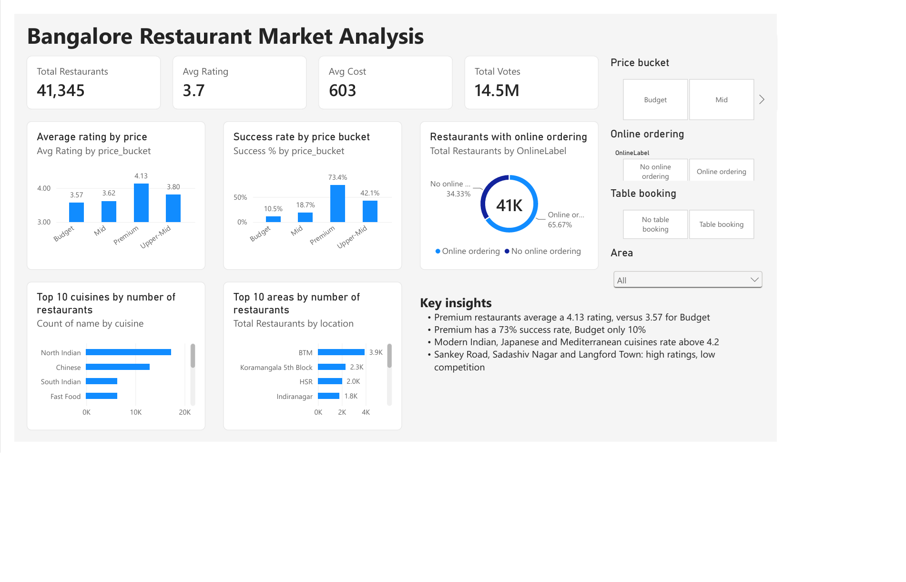
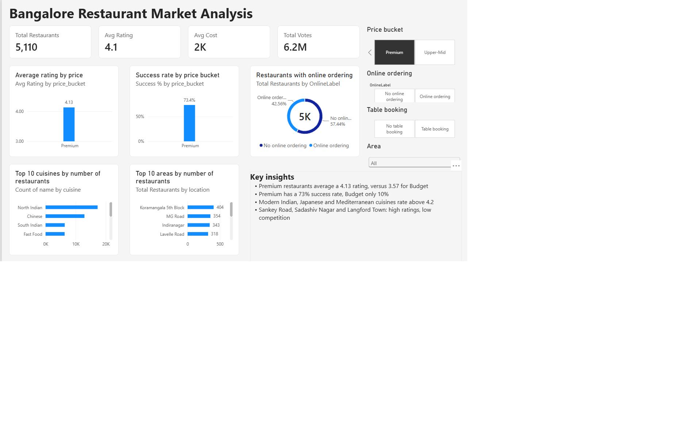

# Zomato Bangalore Restaurant Analysis

## Problem statement
A new restaurant owner wants to open an outlet in Bangalore. This project
analyzes 41,345 Zomato listings to find which price range, cuisine and area
give the best chance of high ratings and strong demand.

## Dashboard



## Dataset
- Source: Zomato Bangalore Restaurants on Kaggle (check this link matches the dataset you downloaded):
  https://www.kaggle.com/datasets/himanshupoddar/zomato-bangalore-restaurants
- 41,345 restaurants after cleaning
- Average rating 3.70, average cost for two Rs 603, 14.5M total votes

## Tools used
Python (Pandas, Matplotlib, Seaborn, SciPy), SQL (SQLite), Power BI

## Data cleaning
- Removed duplicates and unneeded columns (url, phone, address)
- Converted ratings like "4.1/5" to numbers and dropped "NEW" and "-"
- Removed commas from cost and converted to numbers
- Dropped rows with missing rating or cost (ratings cannot be invented)
- Split multi-cuisine cells into one row per cuisine in a separate table

## Key findings
1. Higher price goes with higher ratings: Budget 3.57, Mid 3.62,
   Upper-Mid 3.80, Premium 4.13.
2. Success (rating 4.0+ and above-median votes) rises sharply with price:
   Budget 10.5%, Mid 18.7%, Upper-Mid 42.1%, Premium 73.4%.
3. Table booking: 77.3% of restaurants with booking are successful,
   versus 18.5% without.
4. Best-rated cuisines (50+ restaurants): Modern Indian 4.31,
   Malaysian 4.31, Japanese 4.26, Mediterranean 4.21.
5. Most crowded areas: BTM, Koramangala 5th Block, HSR, Indiranagar.
6. Possible market gaps: Sankey Road (3.97, 26 restaurants),
   Sadashiv Nagar (3.84, 58), Langford Town (3.81, 27).

## Recommendation
An Upper-Mid or Premium restaurant serving a specialty cuisine, with table
booking, in an area such as Sadashiv Nagar or Langford Town.

## Limitations
- The data is a one-time snapshot, with no trend over time.
- Premium restaurants get many more votes, so part of the "success" gap
  comes from the success definition itself.
- High ratings with few restaurants may mean low demand, not unmet demand.
- Koramangala is split across several area names, which understates it.
- Correlation is not causation. Price does not cause better ratings.
- The data cannot show profit or set-up cost.

## How to run
Download the raw data from Kaggle, save it as zomato.csv in the project folder, then run:

```
python clean.py
python load_db.py
python run_sql.py
python eda.py
```

Open zomato.pbix in Power BI Desktop to see the dashboard.